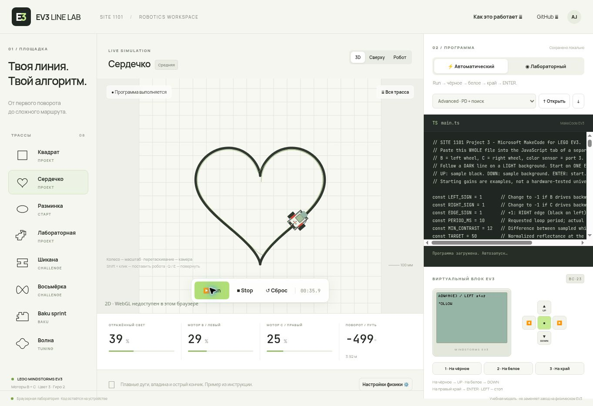

# EV3 Line Lab

[Open simulator](https://alishka5629.github.io/ev3-line-lab/)

A browser robotics workspace for SITE 1101. Eight track presets, 3D EV3-inspired robot with a Canvas 2D fallback, actual Microsoft MakeCode compiler and runtime, source editor, UF2 source import, automatic and manual calibration.

## Run
Node 22+: `npm ci --ignore-scripts`, `npm run prepare-assets`, `npm run dev`.
`npm test` checks the differential-drive model, compiles both programs with the official compiler and verifies compressed UF2 source extraction. `npm run build` creates a self-contained static distribution. GitHub Actions deploys it to Pages when Pages source is set to GitHub Actions.

## Operation
Automatic mode reads program prompts and button waits to position the sensor and perform startup. Programs without a calibration wait start from the right edge. Unrecognized startup conditions show an explanation. Manual mode loads the program and lets you place the sensor and press the brick buttons. Shift-click places the axle; Q/E rotate. Stop terminates the simulated program. LEFT is delivered to the program's button handler.

## Limits
Educational kinematic model, not a hardware-certified digital twin. Geometry, reflectance, noise and wheel slip are configurable; motor dynamics use the PXT EV3 simulator. Gyro angle derives from simulated rate. No rigid-body collision engine. The photographed laboratory track is approximate. Baku City Circuit follows the plan outline traced from the supplied reference image, uniformly scaled to the robot mat. It is flat, without elevation or surveyed real-world dimensions. Arbitrary intersections cannot be resolved by a single reflectance sensor without route policy.
UF2 import recovers embedded MakeCode source and recompiles it, rather than emulating native ARM machine code. Source-less UF2, non-EV3 targets, additional extensions and multi-file projects are rejected or unsupported. Programs run main.ts with the standard EV3 libraries. Runs stop when the browser tab is hidden to avoid background timer throttling. Code is stored locally in the browser; there is no code-upload server.

## Credits
Microsoft pxt-ev3 1.4.41 and pxt-core (MIT); TypeScript (Apache-2.0); LZMA-JS (MIT); Three.js (MIT). Vendor assets are copied from pinned npm packages during build. This is an independent educational project, not affiliated with LEGO or Microsoft. LEGO and MINDSTORMS are trademarks of the LEGO Group.

## Automatic startup
The simulator instruments its bundled MakeCode text and button APIs only during automatic compilation. It reads resolved EV3 text prompts and current button waits, then places the sensor and presses the relevant button. It supports conventional UP/DOWN/ENTER, repeated ENTER and custom button orders with recognizable black/white/edge prompts. Programs without button calibration start on the right edge. Calibration geometry and code are never overwritten. Unknown startup conditions time out with an explanation; image-only prompts and external-input routines may require Laboratory mode. Manual compilation uses the original bundled libraries.

The English interface offers Light and Dark themes. The selection is saved on this device. The track surface retains its physical black/white appearance in either theme.

## Robot speaker
Standard PXT EV3 audio APIs are bridged from the sandbox to Web Audio on the parent page. Run unlocks audio through a browser gesture. Tones retain the official PXT scheduler; Sound.play promises resolve when actual audio ends (or Stop cancels it), including while muted. Embedded WAV recordings and built-in effects are decoded locally. Mute/master volume are separate from program volume. Playback stops on reset, new run or tab hiding; asynchronous decoding cannot restart audio after Stop. The speaker output meter measures the rendered audio signal. Browser permissions or an unsupported codec may block audio; Enable audio shows a recovery path. External extensions and arbitrary file paths are not automatically audio assets. User recordings are never published with the site.
